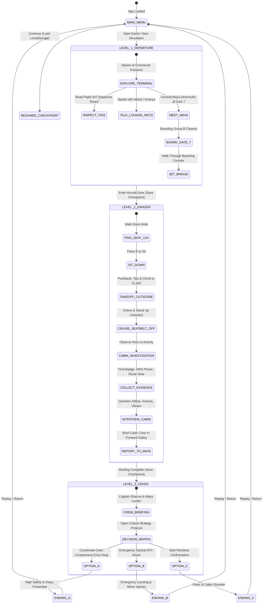

# HIJACK: Every Decision Has a Consequence
### A Third-Year Computer Graphics & Gaming (CGG) Engineering Project

🎮 **Live Playable Web Link:** [https://kartikdigraskar24.github.io/hijack-game/](https://kartikdigraskar24.github.io/hijack-game/)  
*Directly playable on Chrome, Edge, Firefox, Safari — no software installation required.*

---

## 1. Project Abstract
**HIJACK: Every Decision Has a Consequence** is a full 3D real-time interactive aviation thriller developed from scratch for a third-year engineering college Computer Graphics and Gaming (CGG) capstone project. Developed in **React**, **TypeScript**, **Three.js**, **React Three Fiber (R3F)**, **Drei**, and **Vite**, the player assumes the role of **Arjun Mehra**, an observant civil engineer aboard fictional commercial Flight 407. Rather than glorifying tactical combat, the gameplay emphasizes cognitive crisis management, passenger protection, situational awareness, methodical clue gathering, crew communication, and consequential decision-making across three distinct acts.

---

## 2. Problem Statement
Many contemporary video games treat crisis situations either as linear cinematic cutscenes without agency or as pure combat simulations detached from real-world protocols. In educational computer graphics and game design, there is a distinct gap for playable systems that integrate:
- Real-time 3D rendering with procedural animation.
- A stateful consequence engine where forensic evidence determines dialogue unlocks.
- Realistic lighting, balanced exposure, and spatial audio synthesis without external network dependencies.
- Ethical crisis containment emphasizing passenger welfare over graphic violence.

---

## 3. Objectives
1. **Interactive 3D Graphics**: Build a high-performance 3D scene graph featuring detailed airport concourse and passenger airliner interior geometry using WebGL.
2. **Procedural Skeletal Animation**: Implement articulated humanoid models with skeletal kinematics for idle, walk, sit, crouch, and talk cycles without relying on heavy external animation files.
3. **Branching Decision Engine**: Create a decoupled decision matrix that checks collected forensic clues to dynamically unlock mitigation paths.
4. **Spatial Procedural Audio**: Engineer an onboard Web Audio API sound synthesis engine for twin-turbofan engine rumble, airflow hiss, boarding chimes, and tension drones.
5. **Architectural Modularity**: Maintain type-safe TypeScript design separating presentation (HUD/Dossier), gameplay logic (GameState/InputManager), and rendering (Three.js/R3F).

---

## 4. Game Concept & Narrative Structure
- **Protagonist**: Arjun Mehra (30, passenger in Seat 12A).
- **Setting**: Indira Gandhi International Concourse (Gate 7) and Flight 407 (Boeing twin-engine airliner en route to New Delhi).
- **Core Dilemma**: At cruising altitude (FL320), passenger Vikram Malhotra (Seat 14B) prepares to execute an unauthorized flight diversion. Arjun must gather physical proof, coordinate with purser Maya Deshmukh and Captain Rahul Sharma, and resolve the crisis across three divergent endings.

---

## 5. Software and Hardware Requirements
### Software Requirements
- **Operating System**: Windows 10/11, macOS, or Linux.
- **Node.js**: v18.0.0 or higher (v25+ supported).
- **Package Manager**: npm v9+ or yarn.
- **Browser**: Modern WebGL2-compatible browser (Chrome, Edge, Firefox, Brave).

### Hardware Requirements
- **CPU**: Intel Core i3 / AMD Ryzen 3 or higher.
- **RAM**: 4 GB minimum (8 GB recommended).
- **GPU**: Integrated graphics (Intel UHD / Iris Xe / AMD Radeon) or Dedicated GPU.
- **Display**: 1366x768 minimum resolution (1080p recommended).

---

## 6. Technology Stack
| Layer | Technology | Purpose |
|---|---|---|
| **Core Framework** | React 18 & TypeScript 5 | Component lifecycle, strict typing, and reactive UI state |
| **3D Rendering** | Three.js & React Three Fiber (@react-three/fiber) | WebGL rendering, scene graph, lights, meshes, and camera projection |
| **3D Helpers** | @react-three/drei | HTML overlay projection in 3D space (`<Html />`), camera math |
| **Build Tool & Server** | Vite 5 | Instant HMR, ESM bundling, and development server on port 3000 |
| **Audio Engine** | Web Audio API (`AudioContext`) | Procedural synthesizer for jet engine drones, chimes, and SFX |
| **UI Aesthetics** | Vanilla CSS (CSS3) | Aviation dark-navy design system (#050B18, #123B70, #1E73D8) |
| **Icons** | Lucide React | High-tech aviation HUD and dossier glyphs |

---

## 7. System Architecture
```
hijack-game/
├── public/
├── src/
│   ├── app/
│   │   └── App.tsx                 # Master state controller & level transitions
│   ├── components/
│   │   ├── MainMenu.tsx            # Cinematic aviation landing screen
│   │   ├── HUD.tsx                 # Telemetry bars, objective card, keybind badges
│   │   ├── DialoguePanel.tsx       # Branching conversation interface
│   │   ├── DecisionPanel.tsx       # Evidence-locked crisis matrix
│   │   ├── DossierModal.tsx        # Container for Map, Inventory, Investigation
│   │   ├── MapPanel.tsx            # 2D tactical schematic maps (Terminal & B737)
│   │   ├── InventoryPanel.tsx      # Collected items & forensic inspector
│   │   ├── InvestigationPanel.tsx  # Evidence dossier & decision unlocks
│   │   ├── PauseMenu.tsx           # In-game pause & checkpoint restore
│   │   ├── SettingsMenu.tsx        # Volume, FOV, sensitivity, graphics preset
│   │   └── MissionSummary.tsx      # Ending evaluation & post-game debrief
│   ├── game/
│   │   ├── GameCanvas.tsx          # R3F Canvas and level switcher
│   │   ├── GameState.ts            # Immutable state definitions & metrics
│   │   ├── InputManager.ts         # Centralized keyboard & pointer lock controller
│   │   └── SaveManager.ts          # LocalStorage checkpoint persistence
│   ├── player/
│   │   ├── PlayerController.tsx    # Kinematic movement, collision clamps & audio
│   │   └── ThirdPersonCamera.tsx   # Orbital camera with seated/standing modes
│   ├── characters/
│   │   ├── CharacterModel.tsx      # Articulated humanoid mesh with gait cycles
│   │   └── NPCController.tsx       # Proximity tracking & dynamic head orientation
│   ├── environment/
│   │   ├── AirportEnvironment.tsx  # Terminal concourse, FIDS board & lounge
│   │   ├── AircraftInterior.tsx    # B737 passenger cabin, galleys & seat rows
│   │   ├── AircraftExterior.tsx    # Exterior airliner model on apron
│   │   ├── SkyCloudEnvironment.tsx # Moving procedural cloud layers
│   │   └── LightingSetup.tsx       # PBR lighting balanced without washout
│   ├── interactions/
│   │   ├── Collectible.tsx         # 3D interactive clue beacon with floating prompt
│   │   └── SeatInteraction.tsx     # Row 12A sit/stand interaction card
│   ├── levels/
│   │   ├── AirportLevel.tsx        # Level 1: Terminal exploration & boarding
│   │   ├── AircraftLevel.tsx       # Level 2: Cabin exploration & clue hunting
│   │   └── FinalLevel.tsx          # Level 3: Crew briefing & crisis resolution
│   ├── systems/
│   │   └── AudioManager.ts         # Procedural Web Audio API sound generator
│   ├── data/
│   │   ├── characters.ts           # Character profiles & visual styles
│   │   ├── missions.ts             # Objectives across Levels 1-3
│   │   ├── collectibles.ts         # World items, clues, and evidence links
│   │   ├── dialogue.ts             # Branching dialogue tree nodes
│   │   └── decisions.ts            # Strategic decision matrix & 3 endings
│   ├── styles/
│   │   ├── global.css              # Tokens, resets, and typography
│   │   ├── menu.css                # Cinematic menu & settings styles
│   │   └── hud.css                 # HUD, 3D prompts, map SVGs & dossiers
│   └── main.tsx                    # React root mounter
├── package.json
├── tsconfig.json
├── vite.config.ts
└── README.md
```

---

## 8. State Diagram



---

## 9. Control Mapping

| Key / Input | Action | In-Game Behavior |
|---|---|---|
| **W / Up Arrow** | Move Forward | Moves character in forward direction relative to current camera yaw |
| **S / Down Arrow** | Move Backward | Moves character backward relative to camera |
| **A / Left Arrow** | Move Left | Strafes character left relative to camera |
| **D / Right Arrow** | Move Right | Strafes character right relative to camera |
| **Mouse Drag / Look** | Look / Aim | Pitch (vertical clamp) and yaw rotation; pointer lock enabled on click |
| **Space** | Jump | Jumps vertically when grounded (Level 1 exploration only; disabled when seated) |
| **Shift** | Crouch | Lowered center-of-mass crouch for stealth investigation |
| **E** | Interact | Contextual action: Talk to NPC, Inspect FIDS, Sit down, Stand up, Collect Clue |
| **Tab** | Dossier | Toggles tactical dossier: 2D Floorplan Map, Item Inventory, Investigation Log |
| **Esc** | Pause / Back | Pauses game simulation, unlocks pointer lock, opens pause menu |

---

## 10. Three-Level Storyline & Missions

### Level 1 — The Departure
- **Main Objective**: Locate Boarding Gate 7 for Flight 407.
- **Tasks**:
  1. Learn controls and walk through concourse.
  2. Inspect Flight Information Display System (FIDS) to confirm departure time (08:30).
  3. Talk to ground staff and waiting passengers (Aditya & Ananya).
  4. Meet senior purser Maya Deshmukh at Gate 7.
  5. Present boarding credentials, walk through jet bridge corridor, and cross aircraft threshold.
- **Transition**: Fades into forward cabin entrance with autosaved checkpoint `CHECKPOINT_AIRCRAFT_CABIN`.

### Level 2 — Signs of Danger
- **Main Objective**: Experience flight departure, detect anomaly, and uncover physical clues.
- **Tasks**:
  1. Walk down center aisle to Row 12; locate Seat 12A (Window).
  2. Interact with seat to sit down.
  3. Experience flight takeoff sequence (turbofan engine sound surge, clouds gliding past windows).
  4. Seatbelt sign chimes off; press E to stand up.
  5. Investigate suspicious passenger Vikram Malhotra in Seat 14B.
  6. Collect physical clues:
     - **Dropped Security Badge**: Under Row 14B carpet (revoked airport airside pass).
     - **Burner Smartphone**: Inside Seat 14C pocket with incoming diversion instructions.
     - **Encrypted Waypoint Note**: In aft galley service cart.
     - **Cabin Service Log**: Forward galley interphone clipboard noting avionics panel tampering.
  7. Question passengers and report comprehensive findings to Maya in the forward galley.

### Level 3 — Final Decision
- **Main Objective**: Neutralize crisis aboard Flight 407 before reaching critical waypoint.
- **Tasks**:
  1. Captain Rahul Sharma secures armored flight deck and joins forward galley briefing.
  2. Access the **Critical Decision Matrix**.
  3. Formulate response based on gathered clues:
     - **Option A (Discreet Crew Coordination)**: Unlocked by discovering the security badge. Crew and able passengers neutralize the suspect peacefully.
     - **Option B (Air Traffic Control Tactical Divert)**: Unlocked by discovering the waypoint note. Aircraft squawks 7500 and diverts to Jaipur Military Base with security waiting.
     - **Option C (Immediate Solo Tackle)**: Triggers widespread cabin panic and suspect escalation.
- **Outcomes**: Evaluates passenger safety score, crew trust, and renders one of 3 distinct endings.

---

## 11. Decision System & Multiple Endings

### Ending A — The Guardian Resolution (Successful)
- **Requirements**: Player gathered at least 3 clues, coordinated with Maya and crew, and presented evidence calmly.
- **Result**: Suspect detained without violence. All 180 passengers reach destination safely. Zero injuries.

### Ending B — Emergency Contingency Divert (Partial)
- **Requirements**: Player triggered emergency squawk 7500 and diverted without comprehensive suspect containment.
- **Result**: Aircraft lands safely under armed escort; passengers delayed 8 hours with minor bruises from turbulence.

### Ending C — Compromised Resolution (Failed)
- **Requirements**: Player chose uncoordinated solo confrontation or rushed without discovering forensic clues.
- **Result**: Suspect causes cabin hysteria. Armored cockpit bulkhead holds, but emergency slides deploy amidst distress.

---

## 12. Graphics, Computer Graphics & Gaming Techniques
1. **Procedural Skeletal Animation**:
   - `CharacterModel.tsx` implements articulated kinematics with parent-child hierarchical scene graphs.
   - Arms swing in opposing sinusoidal phase with gait cycle; knee and hip joints bend dynamically during walking.
   - Sitting posture rotates hips and knees by $\pi/2$ radians; idle posture incorporates procedural chest breathing expansion.
2. **Physically-Based Rendering (PBR)**:
   - Customized `MeshStandardMaterial` parameters for metalness, roughness, and clearcoat.
   - Aluminum aircraft wings ($metalness=0.3$, $roughness=0.5$), titanium engine nacelles ($metalness=0.6$), textured airline carpet, and polished terminal terrazzo.
3. **PBR Lighting & Shadow Mapping**:
   - Zero washed-out volumetric fog. Directional sun angles with calibrated shadow bias ($-0.0003$) prevent shadow acne.
   - Point light attenuation simulates cabin ceiling LED mood lighting strips and galley task illumination.
4. **Atmospheric Cloud Simulation**:
   - `SkyCloudEnvironment.tsx` dynamically translates dual cloud layers past the aircraft cabin windows at relative velocity to provide realistic sensation of flight at FL320.
5. **Interactive 2D/3D Tactical Projections**:
   - High-performance vector SVG schematics in `MapPanel.tsx` map world coordinates $(X, Z)$ directly to floorplan pins in real time.

---

## 13. Collision & Interaction Techniques
- **Camera-Relative Kinematics**:
  Player velocity vectors $\vec{v}$ are transformed by the camera's horizontal yaw angle $\theta_{yaw}$:
  $$\vec{v}_{world} = \mathbf{R}_y(\theta_{yaw}) \cdot \vec{v}_{local}$$
- **AABB & Clamped Spatial Boundaries**:
  - Airport terminal bounded between $X \in [-14, 14]$ and $Z \in [-14, 24]$.
  - Aircraft cabin bounded to aisle strip $X \in [-0.45, 0.45]$, dynamically widening to $X \in [-1.1, 1.1]$ when player coordinates match seat row intervals.
- **Proximity Detection**:
  Euclidean distance evaluation $\sqrt{(x_p - x_o)^2 + (z_p - z_o)^2} < d_{threshold}$ triggers interactive 3D HTML prompts with zero raycaster overhead.

---

## 14. Procedural Web Audio Engine
The onboard `AudioManager.ts` uses the browser's native **Web Audio API** (`AudioContext`), eliminating external `.mp3` loading failures:
1. **Jet Engine Drone**: 68 Hz sawtooth oscillator + 136 Hz harmonic filtered through a 180 Hz low-pass biquad filter.
2. **Ventilation / Airflow**: Continuous white noise buffer passing through a bandpass filter ($Q=1.2$, $freq=600\text{ Hz}$).
3. **Airport PA Chime**: Harmonious two-tone ding-dong chime ($F5 = 698.46\text{ Hz} \rightarrow C5 = 523.25\text{ Hz}$).
4. **Seatbelt Sign**: High-frequency ding ($G\#5 = 830.61\text{ Hz}$ with $C6$ harmonic).
5. **Clue Discovery**: Mysterious ascending arpeggio ($A4 \rightarrow C\#5 \rightarrow E5 \rightarrow G\#5$).
6. **Crisis Tension Music**: Three-oscillator drone chord ($A1, E2, A2$) active throughout Level 3.

---

## 15. Testing & Verification Procedure
The application was built and validated against the following criteria:
- **TypeScript Typecheck**: Verified zero type errors via `tsc`.
- **Production Build**: Verified clean bundle generation via `npm run build` (Vite).
- **HTTP Server**: Verified port 3000 serves `200 OK` status for `index.html` and assets.
- **Pointer Lock**: Verified smooth transition between cursor-driven mouse look and unlocked UI navigation.
- **Save Persistence**: Verified `localStorage` serializes and reloads level checkpoints correctly.

---

## 16. Installation and Execution Instructions

### Step 1: Install Dependencies
Open PowerShell or Command Prompt inside the project folder:
```powershell
npm install
```

### Step 2: Start Development Server
```powershell
npm run dev
```

The game will launch on **http://localhost:3000/**.

> **Port Conflict Note**:
> If port 3000 is occupied by another process on your machine, Vite will automatically select the next available port (e.g. `http://localhost:3001/`). You can also specify a custom port by running:
> ```powershell
> npx vite --port 3005
> ```

### Step 3: Production Build (Optional)
To build the optimized production package:
```powershell
npm run build
npm run preview
```

---

## 17. Engineering Evaluation Checklist
- [x] Complete playable 3D game built from scratch without placeholders.
- [x] Three full major levels (The Departure, Signs of Danger, Final Decision).
- [x] Playable protagonist (Arjun Mehra) with realistic articulated humanoid geometry.
- [x] Camera-relative movement (WASD, mouse look, jump, crouch).
- [x] Interactive boarding sequence, seat interaction (sit/stand), and takeoff cutscene.
- [x] Complete conversation system with named NPCs (Maya, Aditya, Ananya, Vikram, Staff, Captain).
- [x] Clue collection system with 3D world items and forensic inspector.
- [x] Tab dossier containing tactical 2D maps, inventory cards, and investigation log.
- [x] Evidence-locked critical decision matrix in Level 3.
- [x] Three reachable endings (A: Successful, B: Partial, C: Failed).
- [x] Procedural Web Audio API sound generator (engines, ventilation, chimes, drones).
- [x] Checkpoint and save system via browser localStorage.
- [x] Professional aviation UI styling adhering strictly to the required navy blue palette.
- [x] Zero TypeScript or Vite bundle build errors.

---

## 18. Future Scope
- Integration of WebGPU compute shaders for volumetric cabin air circulation particles.
- Motion-capture character model imports via glTF/GLB with inverse kinematics (IK) foot placement.
- Multiplayer crisis simulation mode with split passenger and cabin crew roles over WebRTC.
